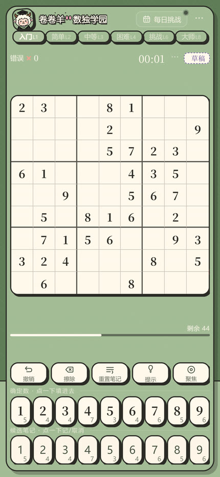
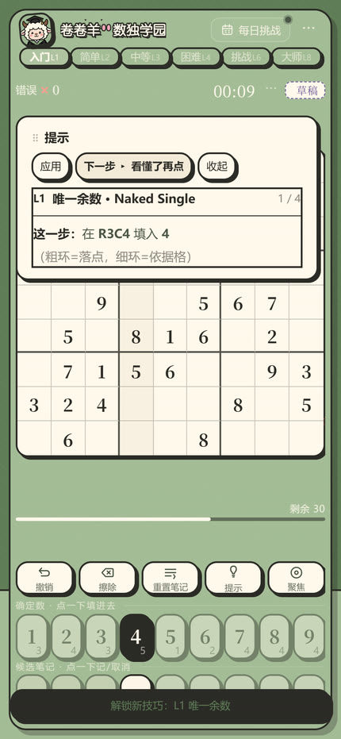
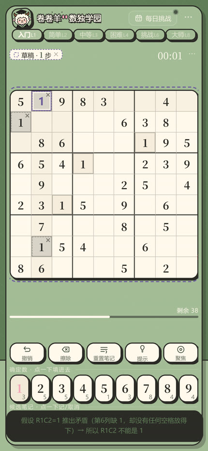
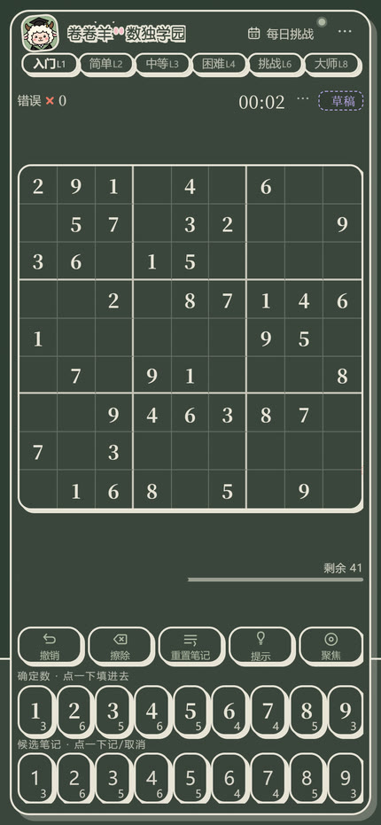

# 卷卷羊 · 数独学园

一个会讲思路的数独小游戏。卡住的时候，它不会直接把答案丢给你，而是说清楚这一步为什么成立。

<p align="center">
  
  
  
  
</p>

## 在线体验

<https://shiyuan170146-bit.github.io/juanjuanyang-sudoku/>

纯前端，打开即玩，不用登录。手机和桌面都有对应版式。

## 和普通数独 App 不一样的地方

**提示讲的是思路，不是答案。** 内置 8 级解题技巧，从最基础的唯一余数、隐性唯一，到需要反证和强制链的复杂局面。点提示时会在盘面上标出结论格和依据格，再配一段话解释这一步为什么成立。同一局里用过的技巧会被记下来，通关后能看到这盘主要考了什么。

**草稿盘。** 数独最难受的时刻是“我想试一个假设，但不试完不知道对不对”。草稿盘是一个独立的推演沙盘：在假设下随便填，它只报逻辑矛盾（重数、候选被清空、某个单元里的数无处可放），绝不拿标准答案来判你。推完点撤回，正式盘面一格没动，记录和计时也不受影响。

**纠错可以整个关掉。** 打开时填错立刻标红、累计错误数、锁住已填对的格子；关掉就完全不判对错、不标红、不锁格。想纯粹靠逻辑推一遍的人可以把它关掉。

**每日挑战。** 每天一道全网同题，打卡图上点亮一格，连续天数会累积。

**挑战好友。** 发起时生成一条带着同一盘题的链接，对方点开就是这一局，比谁快。

**通关掉拼图。** 每通关一局解锁一块拼图，集齐一张解锁一幅画。

## 技术实现

- **零依赖、零后端。** 没有框架、没有构建工具链依赖、没有一个网络请求。全部逻辑在一个脚本里，棋盘尺寸由 JS 实测后写入 CSS 变量，三档断点自适应。
- **一套源码两个产物。** 网页版是内联单文件；小红书小工具的容器 CSP 禁止内联脚本，所以另出一份外置拆分的构建（本仓库就是拆分版）。平台差异只在 `window.ENV` 一处判断，其余代码完全共用。
- **旧内核兼容。** 为容器里的老 WebView 做了 Chrome 61 基线：`inset` 展开成四边、`dvh` 前面补 `vh` 兜底、`:focus-visible` 整条包进 `@supports`、51 处 `color-mix` 在构建期算成静态 `rgba()`。能力探测不通过才挂 `.legacy-c61`，现代内核匹配不到，零像素影响。
- **音效全部现场合成。** 没有音频文件，WebAudio 振荡器实时生成，主总线后接软限幅，避免连击时叠音削波。
- **题库 256 题、6 档难度。** 题目和答案在构建期校验过唯一解，按难度分级，提示引擎的等级与题目难度对应。
- **本地存档。** 进度、做题记录、拼图收集、草稿都存 `localStorage`，关掉浏览器再打开能接着上一局。

## 目录

```
index.html        页面结构（28 KB，无内联脚本）
style.css         全部样式（544 KB，含旧内核兜底层）
main.js           全部逻辑（398 KB，注释保留）
puzzles-data.js   题库与图片资源（2.3 MB，构建期生成）
screenshots/      README 用的截图
```

## 本地运行

题库是外置文件，用静态服务打开最稳：

```bash
python -m http.server 8000
# 然后访问 http://localhost:8000
```

## 说明

本仓库是可直接部署的构建产物。源码由页面模板、样式表、题库三份文件经构建脚本合成为上面这 4 个文件，这样既满足容器对外置脚本的要求，也让代码可读。
